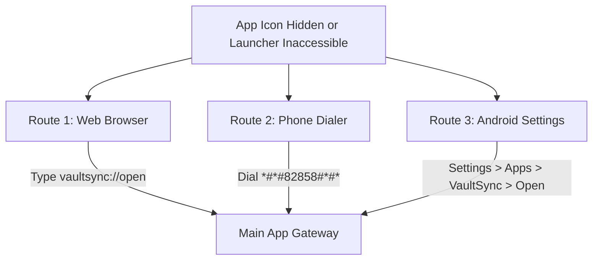

# VaultSync — Complete User Guide & Feature Manual

Welcome to **VaultSync**, a zero-cloud, hardware-encrypted, privacy-first multimedia gallery, secure vault, and local Wi-Fi PC sync solution for Android. This manual explains every feature, architecture component, discreet shortcut, gesture mechanism, and customization option in detail.

---

## Table of Contents
1. [Core Philosophy & Architecture](#1-core-philosophy--architecture)
2. [Main Gallery & Media Management](#2-main-gallery--media-management)
   - [2.1 Timeline vs. Albums Mode](#21-timeline-vs-albums-mode)
   - [2.2 Category Filters, Instant Search & Favorites Filter](#22-category-filters-instant-search--favorites-filter)
   - [2.3 Interactive Pinch-to-Zoom Gallery Grid (2 to 5 Columns)](#23-interactive-pinch-to-zoom-gallery-grid-2-to-5-columns)
   - [2.4 High-Performance Media Viewer (Pinch-to-Zoom, Star Favorites & Material Actions)](#24-high-performance-media-viewer-pinch-to-zoom-star-favorites--material-actions)
   - [2.5 EXIF Metadata Inspector & Privacy Stripper (Share Clean Photo)](#25-exif-metadata-inspector--privacy-stripper-share-clean-photo)
   - [2.6 Enhanced Video Player (Landscape Sizing, Fit vs. Fill & Loop Playback)](#26-enhanced-video-player-landscape-sizing-fit-vs-fill--loop-playback)
   - [2.7 Batch Selection & Delete vs. Trash Clarification](#27-batch-selection--delete-vs-trash-clarification)
3. [The Hardware-Encrypted Vault](#3-the-hardware-encrypted-vault)
   - [3.1 Encryption Pipeline (AES-256-GCM Envelope)](#31-encryption-pipeline-aes-256-gcm-envelope)
   - [3.2 In-Memory Streaming Video Thumbnail Decryption (Zero Disk I/O)](#32-in-memory-streaming-video-thumbnail-decryption-zero-disk-io)
   - [3.3 Persistent Coil 250MB Disk & Memory Caching Architecture](#33-persistent-coil-250mb-disk--memory-caching-architecture)
   - [3.4 Streamlined Vault UI & Navigation Architecture](#34-streamlined-vault-ui--navigation-architecture)
   - [3.5 Move Out of Secret Vault (Restore to Public Gallery)](#35-move-out-of-secret-vault-restore-to-public-gallery)
   - [3.6 Vault Batch Multi-Selection (Move Out, Move/Copy Folders & Permanent Delete)](#36-vault-batch-multi-selection-move-out-movecopy-folders--permanent-delete)
   - [3.7 Vault Password, PIN Management & Biometrics](#37-vault-password-pin-management--biometrics)
   - [3.8 Master Recovery Key (Anti-Lockout)](#38-master-recovery-key-anti-lockout)
4. [Shared Storage & Uninstall-Proof Vault Recovery](#4-shared-storage--uninstall-proof-vault-recovery)
   - [4.1 Storage Architecture & On-Disk Layout](#41-storage-architecture--on-disk-layout)
   - [4.2 Crash-Safe Migration Engine](#42-crash-safe-migration-engine)
   - [4.3 The Encrypted Vault Manifest (`vault_manifest.vsm`)](#43-the-encrypted-vault-manifest-vault_manifestvsm)
   - [4.4 Automatic Existing Vault Discovery & Recovery](#44-automatic-existing-vault-discovery--recovery)
   - [4.5 All Files Access (`MANAGE_EXTERNAL_STORAGE`)](#45-all-files-access-manage_external_storage)
5. [App Camouflage & Stealth Access](#5-app-camouflage--stealth-access)
   - [5.1 Launcher Appearance Modes & Crash-Safe Alias Switching](#51-launcher-appearance-modes--crash-safe-alias-switching)
   - [5.2 The Calculator Disguise (Pure Camouflage Security)](#52-the-calculator-disguise-pure-camouflage-security)
   - [5.3 The Notes Disguise (Pure Camouflage Security)](#53-the-notes-disguise-pure-camouflage-security)
   - [5.4 Secret Multi-Touch Two-Finger Gesture & Live Test Area](#54-secret-multi-touch-two-finger-gesture--live-test-area)
6. [Discreet Vault Access (Long-Press Settings Icon)](#6-discreet-vault-access-long-press-settings-icon)
   - [6.1 How It Works](#61-how-it-works)
   - [6.2 Complete Camouflage of Gallery Lock Buttons](#62-complete-camouflage-of-gallery-lock-buttons)
7. [Anti-Lockout Recovery Routes](#7-anti-lockout-recovery-routes)
   - [7.1 Route 1: Web Browser Deep Link](#71-route-1-web-browser-deep-link)
   - [7.2 Route 2: Telephony Secret Dialer Code](#72-route-2-telephony-secret-dialer-code)
   - [7.3 Route 3: Android System Settings](#73-route-3-android-system-settings)
8. [Local PC Sync (Zero-Cloud Wi-Fi Access)](#8-local-pc-sync-zero-cloud-wi-fi-access)
   - [8.1 How to Connect & Authenticate](#81-how-to-connect--authenticate)
   - [8.2 QR Code Instant Connect & Zero-Typing Pairing](#82-qr-code-instant-connect--zero-typing-pairing)
   - [8.3 PC Web Features & Remote Media Streaming](#83-pc-web-features--remote-media-streaming)
   - [8.4 Uninterrupted Access: WakeLock, Wi-Fi Lock & Screen Keep-Awake](#84-uninterrupted-access-wakelock-wi-fi-lock--screen-keep-awake)
9. [In-App Floating Multi-Window System (PiP)](#9-in-app-floating-multi-window-system-pip)
10. [Two-Stage Secure Trash Bin (Soft-Delete vs. Shred)](#10-two-stage-secure-trash-bin-soft-delete-vs-shred)
11. [Settings & Customization Reference](#11-settings--customization-reference)
    - [11.1 Security & Privacy (Configurable Background Auto-Lock, Master PIN, Biometrics, Recovery Key)](#111-security--privacy)
    - [11.2 Appearance & Camouflage](#112-appearance--camouflage)
    - [11.3 Storage & Recovery](#113-storage--recovery)
    - [11.4 PC Access](#114-pc-access)
    - [11.5 About & Cryptographic Specifications](#115-about--cryptographic-specifications)
12. [Troubleshooting & Emergency FAQ](#12-troubleshooting--emergency-faq)

---

## 1. Core Philosophy & Architecture

VaultSync is engineered around six fundamental privacy and security pillars:

```
┌─────────────────────────────────────────────────────────────────┐
│                     VaultSync Security Pillars                  │
├─────────────────┬───────────────────┬───────────────────────────┤
│ 100% Offline    │ Zero Telemetry    │ AES-256-GCM Hardware Lock │
├─────────────────┼───────────────────┼───────────────────────────┤
│ Stealth Covers  │ Local Wi-Fi Sync  │ Uninstall Survival (Shared)│
└─────────────────┴───────────────────┴───────────────────────────┘
```

- **Zero Cloud / 100% Offline**: VaultSync contains no analytics SDKs, no external tracking, and zero remote cloud dependencies. Your media never leaves your personal hardware.
- **Hardware-Backed Encryption**: Vault files are protected with **AES-256-GCM** authenticated envelope encryption. Encryption keys are sealed and unwrapped through the device's hardware **Android KeyStore** (StrongBox / TEE).
- **Uninstall Survival & Zero Duplication**: Vault media can reside in shared storage (`Documents/VaultSync/`), permanently surviving app uninstalls and re-installations without duplicating or re-encrypting large media files.
- **Camouflage Without Compromising Encryption**: Disguising the launcher icon as a functional Calculator or Notes memo app never replaces or weakens encryption keys or biometric authentication.
- **Discreet Access Pathways**: Built-in long-press gesture shortcuts and multi-touch unlock patterns conceal the presence of private media from curious onlookers.
- **Local PC Streaming**: Zero-cloud Wi-Fi file sharing lets you view and download media from any desktop browser on your local network.

---

## 2. Main Gallery & Media Management

The primary interface of VaultSync is a fluid, high-performance multimedia gallery for Android ([`MediaScreen.kt`](file:///d:/vaultsync/app/src/main/java/com/vaultsync/feature/media/MediaScreen.kt)). All UI controls are rendered with official vector Material Icons (`androidx.compose.material:material-icons-extended`) ensuring crisp rendering across all screen densities.

### 2.1 Timeline vs. Albums Mode
- **Photos (Timeline View)**: Organizes all your photos and videos chronologically, grouped by month and day headers.
- **Albums View**: Displays media organized by device folders (e.g., `Camera`, `Screenshots`, `WhatsApp Images`, `Downloads`, `Screen Recordings`).
- **Tab Switching**: Quickly toggle between **Photos** and **Albums** using the top pill buttons.

### 2.2 Category Filters, Instant Search & Favorites Filter
- **Category Chips**: Quickly filter the gallery stream between **All Media**, **Images**, and **Videos** (showing duration badges and video indicators).
- **Favorites Quick Filter Chip / Button (★ / ☆)**:
  - Located in the circular shortcut controls row at the top of the gallery.
  - Tapping the gold star icon immediately filters your gallery timeline and albums to show **only favorited / starred media items**.
  - Powered by [`FavoritesManager.kt`](file:///d:/vaultsync/app/src/main/java/com/vaultsync/core/media/FavoritesManager.kt) with reactive `StateFlow<Set<String>>` tracking starred IDs.
- **Audio Browser**: Accessible via `⋮ → Browse Audio Files` to browse and play audio recordings and voice notes.
- **Instant Search**: Tap the 🔍 icon in the top bar to filter media names, folder titles, and dates in real time.
- **Multi-Criteria Sorting** (`⋮ → Sort`):
  - **Newest First**: Standard camera timeline.
  - **Oldest First**: Ascending chronological order.
  - **Name (A to Z)**: Alphabetical filename ordering.
  - **Largest File Size**: Pinpoints space-consuming high-resolution media.

---

### 2.3 Interactive Pinch-to-Zoom Gallery Grid (2 to 5 Columns)

VaultSync features an interactive, real-time pinch-to-zoom grid scaling engine in `PhotosGrid` ([`MediaScreen.kt`](file:///d:/vaultsync/app/src/main/java/com/vaultsync/feature/media/MediaScreen.kt)):

```
┌─────────────────────────────────────────────────────────────┐
│                       Gallery Grid Density                  │
├─────────────────┬───────────────────┬───────────────────────┤
│    2 Columns    │     3 Columns     │     4 to 5 Columns    │
│ (Large Details) │     (Standard)    │   (Compact Overview)  │
└─────────────────┴───────────────────┴───────────────────────┘
```

- **Natural Multi-Touch Pinch Gestures**:
  - **Pinch Outward (Expand)**: When your two fingers move apart (`zoomAccumulator > 1.35f`), the grid dynamically scales up thumbnail previews, dropping from 3 columns down to 2 large, high-detail preview cards.
  - **Pinch Inward (Contract)**: When your two fingers pinch together (`zoomAccumulator < 0.72f`), the grid contracts smoothly, increasing density from 3 columns up to 4 or 5 columns for rapid scanning across thousands of media items.
- **State Persistence**: Column density is remembered within [`MediaBrowserState.kt`](file:///d:/vaultsync/app/src/main/java/com/vaultsync/feature/media/MediaBrowserState.kt) (`gridColumnCount: Int = 3`), keeping your preferred layout intact as you browse folders and navigate back.
- **Visual Badges on Grid Thumbnails**:
  - **Gold Star Badge (`Icons.Default.Star`)**: Items marked as favorite display a subtle gold star badge in the top-left corner of the thumbnail.
  - **Selection Checkmark Overlay**: Selected items in multi-select mode display an active border and highlight.
  - **Video Duration Badge**: Video thumbnails display an on-screen duration pill (e.g., `▶ 03:42`).

---

### 2.4 High-Performance Media Viewer (Pinch-to-Zoom, Star Favorites & Material Actions)

Tapping any photo or video launches the fullscreen immersive viewer ([`FullscreenMediaViewer`](file:///d:/vaultsync/app/src/main/java/com/vaultsync/feature/media/MediaScreen.kt#L1355) / [`VaultPreviewViewer.kt`](file:///d:/vaultsync/app/src/main/java/com/vaultsync/feature/vault/VaultPreviewViewer.kt)):

```
┌─────────────────────────────────────────────────────────────┐
│ ←  Camera • 12/148             🗔 (PiP)   ★    ↗️    ⋮    │
├─────────────────────────────────────────────────────────────┤
│                                                             │
│                                                             │
│                    [ Interactive Photo ]                    │
│                 (Pinch to Zoom 1.0x - 5.0x)                 │
│                 (1-Finger Smooth Panning)                   │
│                                                             │
│                                                             │
└─────────────────────────────────────────────────────────────┘
```

#### Upgraded Immersive Top Action Bar
All legacy emojis have been completely replaced with vector Material Icons:
- **Back Button (`Icons.AutoMirrored.Filled.ArrowBack`)**: Returns cleanly to the gallery grid.
- **Title & Position Indicator**: Displays current folder name and position index (e.g., `Camera • 12/148`).
- **Pop-out to Floating Window (`FloatingWindowIcon`)**: Detaches the photo or video into a floating multi-window overlay.
- **Favorite / Star Toggle (`Icons.Default.Star` / `Icons.Default.StarBorder`)**:
  - Instant one-tap starring with vivid `#FFD700` gold feedback.
  - Adds or removes the photo/video from your persistent favorites list via [`FavoritesManager.kt`](file:///d:/vaultsync/app/src/main/java/com/vaultsync/core/media/FavoritesManager.kt).
- **Quick Share Button (`Icons.Default.Share`)**: Opens Android's native Sharesheet.
- **Individual 3-Dot Overflow Menu (`Icons.Default.MoreVert`)**:
  - **Move to Vault (`Icons.Default.Lock`)**: Prompts for immediate hardware AES-256-GCM encryption and relocation to the secure vault.
  - **Share (`Icons.Default.Share`)**: Share photo/video with external messaging or cloud apps.
  - **Rename (`Icons.Default.Edit`)**: Rename the media file in place.
  - **Details & EXIF (`Icons.Default.Info`)**: Opens the comprehensive EXIF metadata inspector and privacy stripper dialog.
  - **Move to Trash / Delete Permanently (`Icons.Default.Delete`)**: Context-aware deletion respecting your Recycle Bin settings.

#### Advanced Multi-Touch Pinch-to-Zoom Engine
- **Continuous 1.0x to 5.0x Zoom**: Smooth multi-touch pinch gesture with real-time hardware pointer tracking.
- **Bounded 1-Finger Pan**: When zoomed in (scale > 1.05x), drag one finger to pan smoothly across the image without triggering unintentional screen swipes.
- **Pager Swipe Isolation**: Swipe-between-photos gesture is safely locked while zoomed in, preventing accidental photo skipping.
- **Double-Tap Quick Zoom**: Double-tap any area of the photo to instantly toggle between 1.0x and 2.5x zoom.
- **Zoom Level Indicator & Reset Chip**: Displays current zoom multiplier (e.g., `2.4x`) with a one-tap reset back to full screen fit.

---

### 2.5 EXIF Metadata Inspector & Privacy Stripper (Share Clean Photo)

Modern mobile cameras embed extensive metadata inside JPEG, PNG, and HEIC image files, including exact GPS coordinates, camera model, lens aperture, and capture timestamps. VaultSync includes a dedicated privacy inspector and stripping utility ([`ExifMetadataInspector.kt`](file:///d:/vaultsync/app/src/main/java/com/vaultsync/core/media/ExifMetadataInspector.kt)):

```
┌─────────────────────────────────────────────────────────────┐
│ ℹ️ Media Details & EXIF                                     │
├─────────────────────────────────────────────────────────────┤
│ Basic Information:                                          │
│   • File Name:     IMG_20261028_160241.jpg                  │
│   • Folder:        Camera                                   │
│   • File Size:     4.2 MB                                   │
│                                                             │
│ Camera & Shot Details:                                      │
│   • Camera Model:  Google Pixel 8 Pro                       │
│   • Capture Specs: f/1.68 • 1/120s • 6.9mm • ISO 50         │
│   • Resolution:    4080 × 3072 (12.5 MP)                    │
│   • Date Taken:    2026:10:28 16:02:41                      │
│   • GPS Coordinates: 37.77490, -122.41940 (Embedded in EXIF)│
├─────────────────────────────────────────────────────────────┤
│    [ 🛡️ Share Clean Photo (Without EXIF / Location) ]       │
└─────────────────────────────────────────────────────────────┘
```

1. **Detailed Hardware & Shot Inspection**:
   - Access via fullscreen viewer: `⋮ → Details & EXIF`.
   - Displays camera make & model, lens aperture (`f/X.X`), shutter exposure time, focal length, ISO speed ratings, sensor resolution (with megapixel calculation), and original capture timestamp.
   - Highlights GPS latitude and longitude if embedded by the device camera.
2. **Share Clean Photo (Privacy Stripper)**:
   - Tapping **"Share Clean (Without EXIF)"** decodes the image in memory and strips away all EXIF tags, GPS location coordinates, camera serial numbers, and device fingerprints.
   - Saves a sanitized image into isolated app cache and dispatches it through Android's secure `FileProvider` ([`AndroidManifest.xml`](file:///d:/vaultsync/app/src/main/AndroidManifest.xml) & [`file_paths.xml`](file:///d:/vaultsync/app/src/main/res/xml/file_paths.xml)).
   - Social media apps, messaging contacts, or external recipients receive the clean photo with zero private location or metadata leak.

---

### 2.6 Enhanced Video Player (Landscape Sizing, Fit vs. Fill & Loop Playback)

The built-in video player ([`EnhancedVideoPlayer.kt`](file:///d:/vaultsync/app/src/main/java/com/vaultsync/core/media/EnhancedVideoPlayer.kt)) is built upon Jetpack Media3 (ExoPlayer) with dedicated mobile enhancements:

```
┌─────────────────────────────────────────────────────────────┐
│ 🔄 Repeat: ON   ↺ 90°   ⚡ 1.0x   🔲 Fit/Fill   🔇 Volume   │
├─────────────────────────────────────────────────────────────┤
│                                                             │
│                    [ Video Stream ]                         │
│             (Double-Tap Left: -10s | Right: +10s)           │
│                                                             │
│ 01:24 ━━━━━━━━━━━━━━━━●────────────────────────── 04:30     │
└─────────────────────────────────────────────────────────────┘
```

- **Seamless Landscape Orientation Adaptation**:
  - When rotating the phone to landscape mode, the video player automatically resizes to full container dimensions without shrinking into a miniature box or distorting aspect ratios.
- **Fit vs. Fill (Crop) Aspect Ratio Toggle**:
  - **Fit Screen (`RESIZE_MODE_FIT`)**: Displays the complete video frame with letterboxing, ensuring no portion of the video is cropped.
  - **Fill Screen (`RESIZE_MODE_ZOOM`)**: Dynamically zooms and crops the video to eliminate black borders, filling modern ultra-wide displays edge-to-edge.
  - Toggling between Fit and Fill adapts instantaneously with clear on-screen badges.
- **Loop / Repeat Playback (`Player.REPEAT_MODE_ONE`)**: Tap the repeat icon to loop short clips or videos continuously.
- **90-Degree Manual Rotation**: Rotate videos (0°, 90°, 180°, 270°) to correct improperly oriented phone recordings.
- **Speed Adjustment**: Select playback speeds from 0.25x (slow motion) to 2.0x (fast forward).
- **Double-Tap Seek**: Double-tap the left third to rewind 10 seconds; double-tap the right third to fast forward 10 seconds.
- **High-Precision Scrubbing Bar**: Smooth progress scrubbing with current timestamp and total duration.

---

### 2.7 Batch Selection & Delete vs. Trash Clarification

VaultSync strictly separates **Moving to Trash** from **Permanent Deletion**:

| Action | What Happens to the File | Can It Be Recovered? | Where Does It Go? |
| :--- | :--- | :--- | :--- |
| **Move to Trash (`Icons.Default.Delete`)** | File is unlinked from gallery and moved to an isolated internal staging directory with original path metadata. | **Yes** — Restore anytime within the retention period (default 30 days). | **Recycle Bin** (`Settings → Trash` or `⋮ → Trash`) |
| **Delete Permanently (`Icons.Default.DeleteForever` / Shred)** | File is cryptographically zero-filled and permanently removed from physical flash storage. | **No** — Irreversible data wipe. | Completely obliterated from device. |

- **Batch Selection**: Long-press any image or album in the gallery to activate multi-select mode.
- The top bar displays selected count with **Share**, **Move to Vault**, and **Move to Trash / Delete** action buttons.
- On Android 11+ (API 30+), media deletion safely integrates with the Android Scoped Storage confirmation prompt (`createTrashRequest` / `createDeleteRequest`).

---

## 3. The Hardware-Encrypted Vault

The **Vault** is an isolated, hardware-encrypted container for sensitive photos, personal documents, and private videos.

```
┌─────────────────────────────────────────────────────────────────┐
│                    AES-256-GCM Vault Container                  │
├─────────────────┬───────────────────┬───────────────────────────┤
│ Unique Per-File │ 96-bit Unique IV  │ Android KeyStore VMK      │
│ 256-bit DEK     │ Authenticated Tag │ (StrongBox / TEE Wrapped) │
└─────────────────┴───────────────────┴───────────────────────────┘
```

### 3.1 Encryption Pipeline (AES-256-GCM Envelope)
1. **Per-File Data Encryption Key (DEK)**: A unique 256-bit cryptographic key is generated using `SecureRandom` for every encrypted file.
2. **Authenticated Chunked Encryption**: The file is encrypted using **AES-256-GCM** with a 96-bit unique IV and 128-bit authentication tag, protecting against both data exposure and bit-flipping tampering attacks.
3. **Hardware KeyStore Master Key (VMK)**: The per-file DEK is encrypted (wrapped) by the Vault Master Key (VMK), which is sealed in the device's hardware KeyStore.
4. **Zero-Trace Original Removal**: The original public file is safely unlinked from MediaStore and overwritten.
5. **Encrypted Thumbnails**: Thumbnail representations are encrypted inside the vault cache to prevent external gallery thumbnail scrapers from discovering hidden images.

---

### 3.2 In-Memory Streaming Video Thumbnail Decryption (Zero Disk I/O)

Older vault designs often decrypt multi-gigabyte video files onto temporary disk files just to generate a preview thumbnail, causing storage wear, battery drain, and security risks.

VaultSync solves this with an **in-memory streaming range decryptor** ([`VaultThumbnailManager.kt`](file:///d:/vaultsync/app/src/main/java/com/vaultsync/core/storage/VaultThumbnailManager.kt)):
- **Android `MediaDataSource` Integration**: The thumbnail manager implements Android's native `MediaDataSource` interface linked directly to `VaultFileDecryptor.readRange`.
- **Targeted Header Streaming**: When Android's `MediaMetadataRetriever` requests video metadata and keyframes, VaultSync decrypts **only the initial few kilobytes/megabytes** of the video container directly in RAM.
- **Zero Temporary Disk Blobs**: Large 1 GB to 4 GB video files are **never** decrypted to temporary unencrypted storage on flash memory.
- **Instantaneous Thumbnail Previews**: Video thumbnails in the vault render almost instantly without I/O wait times.

---

### 3.3 Persistent Coil 250MB Disk & Memory Caching Architecture

To achieve fluid 60fps / 120fps scrolling across large encrypted vaults and galleries, VaultSync configures a dedicated image pipeline in [`VaultSyncApplication.kt`](file:///d:/vaultsync/app/src/main/java/com/vaultsync/VaultSyncApplication.kt):
- **250MB Persistent Disk Cache**: Uses Coil 3 `DiskCache.Builder` in an isolated internal directory (`context.cacheDir/image_cache`) bounded to 250MB.
- **25% RAM Memory Cache**: Allocates up to 25% of available application memory to active bitmap caching with crossfade animations.
- **Automatic LRU Eviction**: When cache boundaries are approached, least-recently-used thumbnail renders are automatically pruned.
- **Fast Startup Renders**: Thumbnails remain cached across app launches, eliminating redundant decryption cycles when browsing your vault.

---

### 3.4 Streamlined Vault UI & Navigation Architecture

The Secret Vault interface ([`VaultMainScreen.kt`](file:///d:/vaultsync/app/src/main/java/com/vaultsync/feature/vault/VaultMainScreen.kt)) has been redesigned for clarity, speed, and discretion with vector Material Icons:

```
┌─────────────────────────────────────────────────────────────┐
│ ←    Albums     Audio                            🔒    ⋮    │
├─────────────────────────────────────────────────────────────┤
│                                                             │
│   📁 Personal (14)            📁 Financial (8)              │
│   📁 Identity Docs (3)        📁 Work Private (22)          │
│                                                             │
│   [ Encrypted Media Thumbnails Grid ]                       │
│                                                             │
└─────────────────────────────────────────────────────────────┘
```

- **Clean Top Bar**:
  - **Back Arrow (`Icons.AutoMirrored.Filled.ArrowBack`)**: Exit the vault and return safely to the main gallery.
  - **View Tabs (`Albums` | `Audio`)**: Toggle between vault image/video folders and private audio recordings.
  - **Quick Lock Button (`Icons.Default.Lock`)**: Immediately purges active encryption keys from memory, locks the vault session, and returns to the lock screen.
  - **3-Dot Overflow Menu (`Icons.Default.MoreVert`)**:
    - **Enable / Disable Biometrics (`Icons.Default.Fingerprint`)**: Fast toggle for fingerprint/face unlock.
    - **Vault Storage & Info (`Icons.Default.Info`)**: Displays encrypted blob size and entry count.
    - **Vault Recovery Key (`Icons.Default.Key`)**: View or export your 128-bit emergency recovery key.
    - **Migrate to Shared Storage (`Icons.Default.DriveFileMove`)**: One-tap migration to `Documents/VaultSync/` so data survives uninstallation.
- **Clutter-Free Canvas**: The redundant bottom navigation rows have been removed, giving you a spacious, distraction-free grid for your private media.

---

### 3.5 Move Out of Secret Vault (Restore to Public Gallery)

If you need to return private photos or videos back to your regular phone gallery, VaultSync provides a dedicated **"Move Out of Vault"** export action:

1. **Single Item Move Out**:
   - Open any photo or video in the Secret Vault viewer ([`VaultPreviewViewer.kt`](file:///d:/vaultsync/app/src/main/java/com/vaultsync/feature/vault/VaultPreviewViewer.kt)).
   - Tap the **Download / Export (`Icons.Default.Download`)** button (or choose **"Move out to Gallery"** from the menu).
   - The file is decrypted using its hardware DEK and securely restored back into your standard Android `Pictures/VaultSync_Restored/` or camera album.
2. **Clean Vault Cleanup**: The encrypted blob inside the vault is immediately deleted, preventing duplicate storage usage.

---

### 3.6 Vault Batch Multi-Selection (Move Out, Move/Copy Folders & Permanent Delete)

You can manage large collections of encrypted files at once:

```
┌─────────────────────────────────────────────────────────────┐
│ ✕   5 Selected   [Select All]            📤   📁   📋   🗑️ │
└─────────────────────────────────────────────────────────────┘
```

1. **Activate Multi-Select**: Long-press any encrypted photo, video, or folder inside the vault.
2. **Contextual Action Toolbar**:
   - **`✕` & Counter**: Displays the number of selected files; tap `✕` to exit selection mode.
   - **Select All / Deselect**: Toggle selection across all files currently displayed in the folder or category.
   - **Move Out of Vault (`Icons.Default.Download`)**: Decrypts and exports all selected items back to the public gallery in a single batch operation.
   - **Move to Folder (`Icons.Default.DriveFileMove`)**: Select a destination vault folder to organize and move items internally.
   - **Copy to Folder (`Icons.Default.ContentCopy`)**: Duplicate selected encrypted files into another vault folder.
   - **Permanent Delete (`Icons.Default.DeleteForever`)**: Prompts confirmation to cryptographically shred all selected items directly from the vault.

---

### 3.7 Vault Password, PIN Management & Biometrics

You can manage your master credentials directly from **Settings → Security & Privacy**:

- **Change Vault Password / PIN**:
  - Tap **"Change Vault Password"** (or **"Create Vault Password"** if setting up a new vault).
  - Prompts for:
    1. **Current Master PIN**
    2. **New Master PIN** (minimum 4 digits)
    3. **Confirm New Master PIN**
  - **Cryptographic Security**: VaultSync unwraps the Vault Master Key (VMK) with your current PIN, validates correctness, re-encrypts the VMK with your new PIN using PBKDF2-HMAC-SHA256, updates the hardware KeyStore wrapper, updates biometric binding, and zeroizes raw keys from memory.
- **Biometric Authentication**:
  - Enrolls fingerprint or face recognition through Android `BiometricPrompt` with `CryptoObject` key unwrapping.
  - Toggling biometrics ON prompts for your Master PIN to link the VMK directly to Android KeyStore hardware cryptography.
- **Direct "Open Secret Vault" Tile**: A dedicated shortcut inside Settings allows you to unlock and open the vault directly without having to navigate back to the gallery.

---

### 3.8 Master Recovery Key (Anti-Lockout)

- **128-bit Cryptographic Hex Key**: VaultSync generates a unique Master Recovery Key in the standard format:
  ```
  VSREC-XXXX-XXXX-XXXX-XXXX-XXXX-XXXX-XXXX-XXXX
  ```
- **Reset PIN**: If you ever forget your Master PIN, tap **Forgot PIN?** on the Vault Lock screen and enter or import this key to safely reset your PIN and restore access to your encrypted files.
- **PIN-Protected Access in Settings**: Tapping **Master Recovery Key** in Settings prompts for your Master PIN before displaying or exporting the key, preventing unauthorized individuals from viewing it.
- **Export to File**: You can export the key directly to a secure text file (`VaultSync_Recovery_Key.txt`) using Android's file picker. Keep this key safely stored offline.

---

## 4. Shared Storage & Uninstall-Proof Vault Recovery

Traditional Android private app storage (`/data/user/0/com.vaultsync.app/files/`) is wiped by the Android operating system whenever an app is uninstalled. VaultSync solves this with **Shared Storage Migration & Automatic Manifest-Driven Recovery**, allowing your encrypted vault to permanently survive app uninstalls, re-installations, and storage cleanups.

```
┌─────────────────────────────────────────────────────────────────┐
│               Crash-Safe Shared Storage Architecture            │
├────────────────────────────────┬────────────────────────────────┤
│ Default App-Private Sandboxing │ Shared Public Storage (Docs)   │
│ context.filesDir/vault/        │ Documents/VaultSync/           │
├────────────────────────────────┴────────────────────────────────┤
│ • Zero Double-Copy: Verified atomic migration, no duplicate MBs │
│ • Zero Re-Encryption: Preserves VSF1 envelope AES-256-GCM DEKs  │
│ • Resumable Journal: Survives process crashes & battery death   │
└─────────────────────────────────────────────────────────────────┘
```

### 4.1 Storage Architecture & On-Disk Layout
When shared storage is active, all vault data resides in standard public external storage under `Documents/VaultSync/`:
```text
Documents/VaultSync/
├── .nomedia                     # Directs Android MediaStore to ignore encrypted blobs
├── vault_manifest.vsm           # Authenticated vault manifest & encrypted catalog
├── blobs/                       # Opaque AES-256-GCM encrypted media files
│   ├── .nomedia
│   ├── 3ec6d3ba-1a85-4b82-862a-60696a860315.vsf
│   └── 3f4c6487-854c-46c8-adad-b84f91fd8e73.vsf
└── migration_journal/           # Atomic crash-safe migration log
    └── migration_journal.json
```

- **Zero Double-Copy Guarantee**: Files are moved atomically or streamed with on-the-fly SHA-256 verification. Source files are only removed after the destination file is verified intact. At no point does VaultSync create duplicate unencrypted or redundant copies.
- **Zero Re-Encryption Invariant**: The individual file encryption (VSF1 chunked AES-256-GCM) and unique data encryption keys (DEKs) are completely preserved.

### 4.2 Crash-Safe Migration Engine
To move an existing vault to shared storage:
1. Open **Settings (`⚙️`) → Media & Storage → Migrate to Shared Storage**.
2. Tap **Start Migration**.
3. The migration engine executes the following crash-safe pipeline:
   - **State Journaling**: Creates `migration_journal.json` tracking phase, entry progress, and checksums.
   - **On-the-Fly Verification**: Verifies SHA-256 hashes during transfer.
   - **Resumability**: If the process is interrupted by an unexpected restart, battery depletion, or OS kill, reopening VaultSync detects the journal and resumes from the exact file that was in progress.
   - **Manifest Generation**: Assembles and encrypts `vault_manifest.vsm`.

### 4.3 The Encrypted Vault Manifest (`vault_manifest.vsm`)
The manifest packages all vault metadata needed to reconstruct your vault on a fresh installation:
- **Format Header & Vault UUID**: Identifies format version (`VSM1`) and unique vault identifier.
- **Dual Wrapped VMKs**: The Vault Master Key is wrapped twice:
  - Once with your **Master PIN / Password** (via PBKDF2-HMAC-SHA256).
  - Once with your **Master Recovery Key** (`VSREC-XXXX-...`).
- **Encrypted Catalog**: All folders, file hierarchies, filenames, MIME types, timestamps, and sizes are serialized and encrypted with **AES-256-GCM** using the VMK and AAD.
- **Background Synchronization**: Any time new files are imported, renamed, or moved into folders, the manifest automatically syncs in the background.

### 4.4 Automatic Existing Vault Discovery & Recovery
When you reinstall VaultSync after an uninstall or on a new setup:
1. **Automatic Discovery**: On launch, VaultSync automatically checks `Documents/VaultSync/` for an existing vault.
2. **Scan Documents Button**: If not found automatically, tap **"Scan Documents for Existing Vault"** on the Vault Setup screen.
3. **Detected Vault Card**: The screen displays your detected vault with its Vault ID and encrypted file count.
4. **Dual Authentication Options**:
   - **Option A**: Enter your previous **Master PIN / Password**.
   - **Option B**: Tap **Use Recovery Key** and enter your generated 128-bit key (`VSREC-...`).
5. **Instant Reconstruction**:
   - The VMK is unwrapped and verified.
   - The encrypted catalog is decrypted into memory.
   - The Room database (all original folders and entry records) is reconstructed.
   - Dynamic storage binds immediately to `Documents/VaultSync/blobs/`.
   - Your photos, videos, and documents open, stream, and preview seamlessly without requiring re-encryption.

### 4.5 All Files Access (`MANAGE_EXTERNAL_STORAGE`)
- On Android 11+ (API 30+), accessing cross-reinstallation files in public `Documents/VaultSync/` requires Android's **All Files Access** permission.
- If this permission is not yet granted, VaultSync displays a **"Permission Required"** card with a direct button to enable it in Android System Settings with one tap.

---

## 5. App Camouflage & Stealth Access

VaultSync provides camouflage capabilities that protect access to the **entire application**, not just the vault.

```
┌─────────────────────────────────────────────────────────────────┐
│                       App Launcher Modes                        │
├─────────────────┬───────────────────┬───────────────────────────┤
│ 1. Normal Mode  │ 2. Calculator     │ 3. Notes Cover            │
│ Standard Icon   │ Math Disguise     │ Memo Pad Facade           │
├─────────────────┴───────────────────┴───────────────────────────┤
│ 4. Hidden Mode: Completely disabled from launcher drawer        │
└─────────────────────────────────────────────────────────────────┘
```

### 5.1 Launcher Appearance Modes & Crash-Safe Alias Switching

| Mode | Icon Name | App Drawer Appearance | Behavior on Launch |
| :--- | :--- | :--- | :--- |
| **Normal** | VaultSync | VaultSync Logo (Photo & Lock) | Opens Main Gallery (with optional launch lock) |
| **Calculator** | Calculator | Dark Minimalist Calculator | Opens working math calculator facade (Gesture unlocks gallery) |
| **Notes** | Notes | Yellow/Black Memo Pad | Opens functional personal notes facade (Gesture unlocks gallery) |
| **Hidden** | *None* | Icon is removed from Launcher | App does not appear anywhere in App Drawer |

#### Crash-Safe Alias Switching Mechanism
In standard Android implementations, dynamically changing launcher icons via `pm.setComponentEnabledSetting` causes the Android OS to immediately kill the running app process with `ACTION_PACKAGE_CHANGED`.

VaultSync uses a dual-phase alias synchronization engine ([`AppIconManager.kt`](file:///d:/vaultsync/app/src/main/java/com/vaultsync/core/stealth/AppIconManager.kt) & [`MainActivity.kt`](file:///d:/vaultsync/app/src/main/java/com/vaultsync/MainActivity.kt)):
1. **Immediate Target Alias Activation**: When you tap a camouflage option in Settings, VaultSync immediately activates the target launcher component without disabling the currently running alias. This prevents the app from closing or crashing.
2. **Background Alias Synchronization (`MainActivity.onStop`)**: Once you minimize or exit the app, VaultSync cleanly disables inactive launcher aliases in the background. The app icon changes on your home screen cleanly with zero process interruption.

---

### 5.2 The Calculator Disguise (Pure Camouflage Security)
When disguised as Calculator:
- **100% Authentic Math Engine**: Performs real addition, subtraction, multiplication, division, percentages, and decimals. Anyone can use it without noticing anything unusual.
- **Pure Disguise Security**: Direct PIN entry on `=` and title tap shortcuts have been completely eliminated. Typing any numbers or PIN and pressing `=` calculates math exclusively.
- **Exclusive Multi-Touch Gesture Entry**: The **only way** to unlock the main gallery is by performing your secret two-finger gesture (e.g., Two-Finger Swipe Down) on the screen.

---

### 5.3 The Notes Disguise (Pure Camouflage Security)
When disguised as Notes:
- **Realistic Memo Interface**: Displays mock personal notes, checklists, and search headers.
- **Authentic Note Actions**: Tapping **"Edit"** toggles note selection mode ("Done" / "Edit"). Tapping any note card opens a full note reader dialog with a "Done" button.
- **Pure Disguise Security**: Direct access buttons (such as the Edit button or note taps) do not open the gallery, preventing accidental exposure when someone inspects the app.
- **Exclusive Multi-Touch Gesture Entry**: The **only way** to unlock the main gallery is by performing your secret two-finger gesture on the screen.

---

### 5.4 Secret Multi-Touch Two-Finger Gesture & Live Test Area

A custom multi-touch gesture detector ([`TwoFingerGestureDetector.kt`](file:///d:/vaultsync/app/src/main/java/com/vaultsync/core/stealth/TwoFingerGestureDetector.kt)):
- **Enforced in Disguised Modes**: When Calculator or Notes mode is active, the two-finger gesture is strictly enabled so you always have guaranteed access to your gallery.
- **Configurable Gesture Types**:
  - **Swipe Down (Default)**: Drag two fingers downward by at least `32.dp`.
  - **Swipe Up**: Drag two fingers upward by at least `32.dp`.
  - **Double Tap**: Tap twice in quick succession with two fingers.
- **Hardware-Calibrated Tracking**: Uses persistent `PointerId` tracking so swapped finger order or uneven hand angles never break recognition.
- **Haptic Confirmation**: Emits an instant haptic vibration upon recognition.
- **Interactive In-Line Gesture Test Box**: Settings features a live test area (`Appearance & Camouflage`) where you can practice your two-finger gesture and verify instant tactile feedback before leaving the app.

---

## 6. Discreet Vault Access (Long-Press Settings Icon)

To ensure privacy, having an obvious lock button in your public gallery can alert onlookers that you have private files.

```
                    ┌────────────────────────────┐
                    │      Gallery Top Bar       │
                    │  🔍    💻    ⚙️ (Hold)  ⋮  │
                    └──────────────┬─────────────┘
                                   │
                       Long-Press Settings Icon
                                   │
                                   ▼
                    ┌────────────────────────────┐
                    │     Vibration Buzz 📳      │
                    │     Secret Vault Opens!    │
                    └────────────────────────────┘
```

### 6.1 How It Works
- **Single Tap on ⚙️**: Opens **Settings** normally.
- **Long Press on ⚙️ (0.5s)**: Vibrates with haptic feedback and **opens the Secret Vault**!

### 6.2 Complete Camouflage of Gallery Lock Buttons
When **"Secret Vault via Settings Long-Press"** is enabled in Settings:
- The circular **Secure Vault** button in the shortcuts row is **hidden**.
- The top bar **Lock** button is **hidden**.
- The **"Secure Vault"** item in the overflow (`⋮`) menu is **hidden**.
- The gallery looks 100% like an ordinary photo viewer with zero clues that a hidden vault exists.

---

## 7. Anti-Lockout Recovery Routes

If you use **Hidden Mode** (where the launcher icon is disabled) or forget your gesture, VaultSync provides three recovery access routes to prevent permanent lockout.



### 7.1 Route 1: Web Browser Deep Link
Open Chrome, Samsung Internet, or any web browser and enter:
```
vaultsync://open
```
or
```
vaultsync://recover
```
Android will identify VaultSync's registered intent filter and immediately launch the app.

### 7.2 Route 2: Telephony Secret Dialer Code
Open your phone's dialer / phone keypad and enter:
```
*#*#82858#*#*
```
*(Tip: `82858` spells `VAULT` on standard telephone keypads).*
A backup dialer code is also supported:
```
*#*#1234#*#*
```
The telephony `SECRET_CODE` broadcast receiver will immediately wake and open the app.

### 7.3 Route 3: Android System Settings
1. Open your phone's **Settings**.
2. Go to **Apps** → **All Apps**.
3. Locate **VaultSync** (or **Calculator** / **Notes** if disguised).
4. Tap **Open** at the bottom of the App Info screen.

---

## 8. Local PC Sync (Zero-Cloud Wi-Fi Access)

VaultSync allows you to view, browse, stream, and download media from your computer's web browser without cables, internet, or third-party cloud servers.

```
┌─────────────────┐       Local Wi-Fi Network       ┌──────────────────┐
│ Android Device  │ ◄─────────────────────────────► │    Desktop PC    │
│ VaultSync Server│   (Encrypted Token Handshake)   │ Chrome / Firefox │
└─────────────────┘                                 └──────────────────┘
```

### 8.1 How to Connect & Authenticate
1. Ensure your phone and PC are connected to the same Wi-Fi network (or connect your PC to your phone's Wi-Fi Hotspot).
2. Tap the **💻 PC Sync** icon in the gallery top bar (or open `⋮ → PC Sync`).
3. Tap **Start Wi-Fi Server**.
4. The screen displays:
   - **Local Address**: E.g., `http://192.168.1.45:8080`
   - **Access PIN / Token**: E.g., `849201`
   - **QR Code**: Scan for instant pairing.

---

### 8.2 QR Code Instant Connect & Zero-Typing Pairing

VaultSync integrates real-time QR code generation ([`QrCodeView.kt`](file:///d:/vaultsync/app/src/main/java/com/vaultsync/core/designsystem/QrCodeView.kt)) directly inside [`PcAccessScreen.kt`](file:///d:/vaultsync/app/src/main/java/com/vaultsync/feature/pcaccess/PcAccessScreen.kt):

```
┌─────────────────────────────────────────────────────────────┐
│                 SCAN FOR INSTANT PAIRING                    │
│                                                             │
│                      ┌───────────────┐                      │
│                      │ █▀▀▀▀▀ ▀ █▀▀▀▀│                      │
│                      │ █ ███ █▀ █ ███│                      │
│                      │ █▀▀▀▀▀ █ █▀▀▀▀│                      │
│                      │ ▀▀▀▀▀▀▀▀▀▀▀▀▀▀│                      │
│                      └───────────────┘                      │
│                                                             │
│  Scan with laptop webcam, tablet, or phone camera on the    │
│  same Wi-Fi network to connect automatically.               │
└─────────────────────────────────────────────────────────────┘
```

- **Zero-Typing Instant Login**:
  - The QR code encodes a secure URL payload: `http://<ip>:<port>#passcode=<6-digit-code>`.
  - When scanned using a laptop webcam, iPad, or secondary device, the web companion client in [`app.js`](file:///d:/vaultsync/app/src/main/assets/web/app.js) automatically reads the `#passcode=` hash fragment, populates the input field, and performs immediate background handshake authentication.
  - No manual typing of IP addresses, ports, or 6-digit access PINs required.
- **On-Demand Passcode Regeneration**: Tap the refresh icon (`Icons.Default.Refresh`) on the pairing card at any time to invalidate old sessions and issue a new random 6-digit passcode.

---

### 8.3 PC Web Features & Remote Media Streaming
- **High-Res Media Grid with Video Thumbnails**: View camera photos, vault photos, and videos in desktop resolution. Video files display real hardware-extracted frame thumbnails with an elegant translucent play overlay (`▶`), eliminating generic blank placeholders.
- **Hardware-Accelerated Frame Extraction**: The phone automatically generates lightweight JPEG video thumbnails on-demand (via `loadThumbnail` on Android 10+ and `MediaMetadataRetriever` fallback) for both device media (`/api/media/thumbnail/{id}`) and encrypted vault entries (`/api/vault/thumbnail/{id}`).
- **Dual-Layer Browser Fallback**: If a video codec cannot be extracted natively, the web client gracefully uses client-side HTML5 canvas frame extraction or displays a stylized video badge without blocking page rendering.
- **Direct Video Streaming & Poster Buffering**: Stream recorded videos directly in your browser with HTTP range seeking without downloading the full file first. The video player displays the thumbnail as an instant poster frame while buffering.
- **Download Media**: Download individual media items or bulk select albums as a `.zip` archive.
- **Vault Elevation with Master PIN**: Accessing encrypted vault files from the desktop browser strictly requires entering your Vault Master PIN.
- **Session Security**: The local HTTP server enforces private subnet CORS restrictions and automatically terminates when disconnected or when you tap **Stop Server**.

---

### 8.4 Uninterrupted Access: WakeLock, Wi-Fi Lock & Screen Keep-Awake
To prevent connection drops when phones sleep or turn off screens:
1. **Automatic Screen Keep-Awake (`FLAG_KEEP_SCREEN_ON`)**: While viewing the PC Access screen, the display stays awake so you can clearly see the pairing PIN and server address.
2. **Persistent Foreground Service ([`PcAccessService.kt`](file:///d:/vaultsync/app/src/main/java/com/vaultsync/core/server/PcAccessService.kt))**: Running as a dataSync foreground service prevents the OS from terminating the server when switching apps.
3. **Hardware CPU WakeLock (`PowerManager.PARTIAL_WAKE_LOCK`)**: The CPU remains active if you press the power button, ensuring background streaming continues uninterrupted.
4. **High-Performance Wi-Fi Lock (`WifiManager.WIFI_MODE_FULL_HIGH_PERF`)**: Keeps the Wi-Fi chip in low-latency active state.
5. **Notification Tray Controls**: Live notification shows server URL, client count, and a one-tap **"Stop"** button.

---

## 9. In-App Floating Multi-Window System (PiP)

VaultSync includes a multi-instance picture-in-picture floating window overlay ([`FloatingWindowManager.kt`](file:///d:/vaultsync/app/src/main/java/com/vaultsync/core/floating/FloatingWindowManager.kt)).

- **Multiple Simultaneous Windows**: Open multiple photos and videos at the same time in floating windows.
- **Freeform Dragging**: Touch and drag any window's title bar to reposition it anywhere on your screen.
- **Pinch & Corner Resize**: Grab window edges or pinch to adjust width and height.
- **Video Playback in Window**: Floating videos include play/pause, scrub bars, and mute controls.
- **Minimize to Floating Bubble**: Collapse any active window into a compact circular bubble on the screen edge. Tap the bubble anytime to restore the window.

---

## 10. Two-Stage Secure Trash Bin (Soft-Delete vs. Shred)

Accidental deletions in VaultSync are protected by an isolated, two-stage trash system ([`TrashScreen.kt`](file:///d:/vaultsync/app/src/main/java/com/vaultsync/feature/trash/TrashScreen.kt)).

```
┌──────────────┐     Delete Action     ┌─────────────────┐     Shred / Empty     ┌────────────────┐
│ Main Gallery │ ────────────────────► │  Trash Bin      │ ────────────────────► │ Permanent Wipe │
│ Public Media │                       │ (Auto-Purge 30d)│                       │ (Zero-Fill)    │
└──────────────┘                       └────────┬────────┘                       └────────────────┘
                                                │
                                                │ Restore
                                                ▼
                                       ┌─────────────────┐
                                       │ Original Folder │
                                       └─────────────────┘
```

- **Soft-Delete Staging**: Deleting an item removes it from the public gallery and moves it to the staging area with original directory path metadata.
- **Restore Capability**: Open **Settings → Trash** or `⋮ → Trash` to view deleted items. Tap **Restore** to return any photo or video to its exact original folder.
- **Empty Trash / Permanent Shredding**: Tap **Empty Trash** to permanently overwrite and delete files with zero recovery possibility.
- **Storage Metrics**: The trash screen displays total deleted file count and consumed storage space.
- **Configurable Auto-Purge**: Choose automatic retention periods of 7, 14, 30, 60, or 90 days.

---

## 11. Settings & Customization Reference

A complete breakdown of every option available in **Settings (`⚙️`)**:

### 11.1 Security & Privacy
- **Configurable Background Auto-Lock**:
  - Automatically re-locks sensitive vault content and purges decrypted memory buffers after the app is minimized.
  - Tapping **"Auto-Lock on Background"** in Settings opens an interactive duration selector dialog ([`AutoLockTimeout`](file:///d:/vaultsync/app/src/main/java/com/vaultsync/core/stealth/StealthPreferences.kt#L65)):
    - **Immediately on exit** (`0s`): Locks the vault the moment you switch away or minimize.
    - **After 30 seconds** (`30s`): Grace period for quick app switching (e.g. copying a code or taking a quick note).
    - **After 1 minute** (`60s`): Locks after 60 seconds of background inactivity.
    - **After 5 minutes** (`300s`): Locks after 5 minutes of background inactivity.
    - **Manual lock only** (`-1s`): Vault stays unlocked until you tap the quick lock button (`Icons.Default.Lock`) or exit the vault.
  - Lifecycle tracking in [`MainActivity.kt`](file:///d:/vaultsync/app/src/main/java/com/vaultsync/MainActivity.kt) ensures zero battery drain while calculating background duration accurately upon app resume.
- **Change Vault Password**:
  - Prompts for Current Master PIN, New Master PIN, and Confirmation.
  - Updates cryptographic VMK wrapping and Android KeyStore bindings.
- **Open Secret Vault**:
  - Direct shortcut tile to unlock and open the encrypted vault without navigating through the gallery.
- **Biometric Authentication**:
  - Validates hardware support via `BiometricManager` and prompts for Master PIN (`BiometricAuthPinDialog`) to link Android KeyStore hardware cryptography.
- **Master Recovery Key**:
  - PIN-protected access (`RecoveryKeyPinPromptDialog`) to view, copy, or export your 128-bit emergency recovery key (`VSREC-...`).
- **Screen Protection (`FLAG_SECURE`)**:
  - Permanently active; blocks screenshots and screen recording, and masks app content in Android Recent Tasks.
- **Lockout Recovery Guide**:
  - Displays recovery dialer codes (`*#*#82858#*#*`) and browser deep links (`vaultsync://open`).

### 11.2 Appearance & Camouflage
- **Launcher Icon Mode Cards**:
  - Select between **Normal Mode**, **Disguised: Calculator**, **Disguised: Notes**, and **Hidden Mode**.
  - Applies alias immediately in the foreground and synchronizes cleanly upon app backgrounding (`onStop()`), preventing crashes.
- **Normal Mode Launch Lock**:
  - Require Master PIN or biometric authentication immediately upon opening the app.
- **Pure Disguise Security Badge**:
  - Verifies that all obvious edit buttons or visual triggers on Calculator/Notes covers are removed.
- **Secret Two-Finger Gesture**:
  - Configure gesture type: **Swipe Down**, **Swipe Up**, or **Double Tap**.
  - **Interactive Live Test Box**: Practice your gesture and verify tactile vibration feedback.
- **Gallery Secret Shortcuts**:
  - **Secret Vault via Settings Long-Press**: Hold `⚙️` for 0.5s to open the vault; hides all visible vault lock buttons across the gallery.

### 11.3 Storage & Recovery
- **Storage Breakdown**:
  - Live metrics for Available Device Space, Encrypted Vault Storage, and Recycle Bin Space.
- **Storage Mode**:
  - Displays current location (**Internal Sandboxed** vs. **Documents/VaultSync Shared**).
- **Migrate to Shared Storage**:
  - Resumable, crash-safe migration moving encrypted blobs to public `Documents/VaultSync/` so data survives app uninstallation.
- **Scan for Existing Vaults**:
  - Scans `Documents/VaultSync/` to discover existing `.vsm` manifests and `.vsf` containers.
- **Trash & Recycle Bin Management**:
  - Toggle Recycle Bin, customize Auto-Purge duration (7 to 90 days), and empty trash.
- **Clean Stale Temporary Files**:
  - Asynchronous background cleanup (dispatched on IO thread) to clear leftover temporary import or thumbnail cache files without UI lag.

### 11.4 PC Access & Settings Quick-Toggle
- **One-Tap Quick Toggle from Main Settings Menu**:
  - The main Settings screen features a dedicated switch directly on the **PC Access** tile.
  - Turn the Wi-Fi sync server **ON** or **OFF** instantly without leaving the main settings menu.
  - When active, the tile displays real-time connection status (e.g., `Active on http://192.168.1.45:8080 • PIN 482910`) alongside a vibrant green status badge.
- **Dedicated PC Access Sub-Screen**:
  - **Master Server Switch**: Integrated switch card with live state indicators (`SERVER LIVE` vs `SERVER STOPPED`).
  - **One-Tap Copy**: Quick copy button for the local web browser URL.
  - **Dynamic PIN Management**: View the temporary 6-digit passcode with an instant **"Refresh"** generator button.
  - **Live Session Metrics**: Displays connected browser session count and local Wi-Fi SSID.
  - **Fullscreen QR Code Pathway**: Direct link to open the full QR code pairing card for laptop/tablet camera auto-connect.
- **Background Performance & Security**:
  - Screen keep-awake toggle, CPU WakeLock, Wi-Fi Lock, and ongoing foreground notification controls.
  - Strict local subnet isolation preventing external web page bridging.

### 11.5 About & Cryptographic Specifications
- Displays cryptographic specifications (AES-256-GCM envelope, StrongBox / TEE KeyStore, zero-cloud verification).
- Shows software build version and offline privacy guarantees.

---

## 12. Troubleshooting & Emergency FAQ

### Q1: How do I change my Vault PIN or Password?
> Open **Settings (`⚙️`) → Security & Privacy → Change Vault Password**. Enter your current Master PIN, followed by your new PIN and confirmation. VaultSync will securely re-encrypt your Vault Master Key and update biometric hardware bindings immediately.

### Q2: How do I zoom in and change gallery grid density (column count)?
> Simply pinch with two fingers anywhere on the media grid in the **Photos** tab or inside an album:
> - **Pinch Outward**: Zooms in, decreasing columns from 3 to 2 for large, detailed previews.
> - **Pinch Inward**: Zooms out, increasing columns up to 4 or 5 for a compact high-density overview.
> Your preferred column density is automatically remembered as you browse.

### Q3: How do I star or favorite media, and how do I view only favorites?
> - **To Star a Media Item**: Open any photo or video in fullscreen view and tap the **Star icon (★)** in the top bar. A gold star badge will also appear on the thumbnail in the gallery grid.
> - **To View Only Favorites**: Tap the circular **Star Shortcut Button (★)** at the top of the main gallery screen. The gallery will filter immediately to display only your starred photos and videos. Tap it again to return to the full gallery view.

### Q4: How do I inspect photo camera details and share photos without location metadata?
> 1. Open any photo in the fullscreen viewer and tap `⋮ → Details & EXIF`.
> 2. The dialog displays complete camera specs (Model, Aperture, Exposure, Focal Length, ISO, Resolution, and embedded GPS coordinates).
> 3. To protect your privacy, tap **"Share Clean Photo (Without EXIF)"**. VaultSync will generate a sanitized copy stripped of all GPS location coordinates and device metadata, launching Android's Sharesheet securely.

### Q5: How does instant QR code pairing work for PC Sync?
> When you tap **Start Wi-Fi Server** in the PC Access screen, a QR code appears automatically. Point your laptop webcam, tablet, or another phone's camera at the QR code. The browser will open the local URL and automatically authenticate using the embedded passcode hash—no typing required!

### Q6: How do I adjust how quickly the Vault locks after switching apps?
> Go to **Settings (`⚙️`) → Security & Privacy → Auto-Lock on Background**. You can choose between **Immediately on exit**, **After 30 seconds**, **After 1 minute**, **After 5 minutes**, or **Manual lock only**.

### Q7: How do I move photos or videos out of the Secret Vault back to my normal gallery?
> **For a single photo/video**: Open it inside the Secret Vault viewer, tap the **Download icon (`Icons.Default.Download`)** or the 3-dot menu (`⋮`), and select **"Move out to Gallery"**.  
> **For multiple photos/videos**: Long-press any item inside the vault to activate multi-select mode, select your items, and tap the **Move Out (`Icons.Default.Download`)** icon in the top action bar. All selected media will be decrypted and restored to your device's public camera roll.

### Q8: How do I select multiple files in the Secret Vault to move or copy them to another folder?
> Long-press any item in the Secret Vault to enter selection mode. Select your desired items (or tap **"Select All"**). Tap the **Folder Move (`Icons.Default.DriveFileMove`)** icon to relocate them to another vault folder, or the **Copy (`Icons.Default.ContentCopy`)** icon to duplicate them.

### Q9: I tapped a camouflage mode (Calculator or Notes) in Settings and in older apps it used to crash or disappear. Is that fixed?
> Yes. VaultSync features crash-safe alias synchronization ([`AppIconManager.kt`](file:///d:/vaultsync/app/src/main/java/com/vaultsync/core/stealth/AppIconManager.kt)). Activating a disguise immediately enables the new launcher alias in the foreground without terminating the active window. Disabling inactive aliases is safely deferred until you minimize the app, completely preventing Android's `ACTION_PACKAGE_CHANGED` system crash.

### Q10: When rotating a video to landscape, the video used to become too small or the Fit/Fill button didn't work. How does it work now?
> The video player ([`EnhancedVideoPlayer.kt`](file:///d:/vaultsync/app/src/main/java/com/vaultsync/core/media/EnhancedVideoPlayer.kt)) automatically adapts to landscape dimensions without shrinking or stretching. Tap the **Fit / Fill toggle** (`🔲`) in the top controls bar to switch between:
> - **Fit Screen**: Shows the full video frame with letterboxing.
> - **Fill Screen**: Dynamically zooms to eliminate black borders and fill modern displays edge-to-edge.

### Q11: What is the difference between "Move to Trash" and "Delete Permanently"?
> - **Move to Trash (`Icons.Default.Delete`)**: A soft-delete that places files in VaultSync's isolated Recycle Bin with original folder metadata. You can restore these files at any time within your retention window (default 30 days).
> - **Delete Permanently (`Icons.Default.DeleteForever`)**: A cryptographic zero-fill shredding operation that permanently wipes the file from physical storage. Shredded files can never be recovered.

### Q12: I enabled Hidden Mode and cannot find the app on my home screen. How do I open it?
> Open your phone's web browser and type `vaultsync://open` in the address bar. Alternatively, open your phone's dialer app and dial `*#*#82858#*#*`.

### Q13: How do I open the Secret Vault if there are no lock buttons in the gallery?
> Press and hold the **Settings icon (`⚙️`)** in the top bar of the gallery for 0.5 seconds. You will feel a haptic vibration and the Secret Vault will open. (You can also toggle standard lock buttons back on anytime in **Settings → Appearance & Camouflage**).

### Q14: What happens to my vault if I uninstall and reinstall VaultSync?
> If your vault is in **Shared Storage** (`Documents/VaultSync/`), your encrypted media, folders, and encrypted manifest permanently survive uninstallation. When you reinstall VaultSync, the app automatically detects the existing vault and offers one-tap recovery using your previous PIN or Recovery Key.

---
*VaultSync Documentation — Version 2.4 (Engineering & UI Modernization, Pinch-Zoom Grid, EXIF Privacy Stripper, QR Instant Pairing & Auto-Lock Release)*
